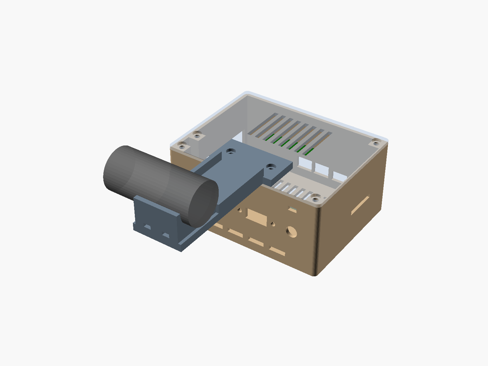

# Brain box enclosure

Box for the Raspberry Pi 5 with the official Active Cooler and the HAT+ on
19 mm standoffs, with a service bay for the power jack, USB-A extension, two
cable glands and the float-switch lead, plus a lid-mounted bracket that hangs
the peristaltic pump over the reservoir next to the box.
Source: [`brain.scad`](brain.scad). Previews: [assembly](preview_assembly.png),
[print plate](preview_print_plate.png).



## Parts

| STL | What | Size (mm) | Orientation in the STL |
|---|---|---|---|
| `stl/box.stl` | body with Pi posts, four lid posts, all wall cutouts, floor vents, feet recesses, keyholes | 113 × 88 × 53 | floor on the bed |
| `stl/lid.stl` | lid with locating lip, exhaust slots over the cooler, two inserts for the pump bracket | 113 × 88 × 9 | top face on the bed |
| `stl/pump_bracket.stl` | cantilever cradle for a Kamoer NKP-style pump (Ø 27.5 motor) | 46 × 103 × 23 | base plate on the bed |

## Printing

- **Material:** PETG (PLA is fine if the box stays indoors and out of the sun; the Pi runs warm).
- **Layer height:** 0.2 mm.
- **Walls:** 3 perimeters (walls, floor and lid are 2.4 mm).
- **Infill:** 20 %; 30 % for the pump bracket.
- **Supports:** none. `../check_stl.py` confirms no surface overhangs beyond
  45°. The barrel-jack and gland holes have teardrop tops. The port window on
  the right wall is one 54 mm bridge (the slicer will bridge it; if your
  printer bridges badly, set `pi_ports_one_window = false` for three separate
  windows once you have checked the port positions against your Pi).
- **Brim:** not needed.

## Hardware

| Qty | Item | Where |
|---|---|---|
| 4 | M2.5 heat-set insert (Ø 3.5 hole) | Pi posts in the floor |
| 4 | M2.5 male–female standoff, 19 mm (extra-tall header height) | screw the male end through the Pi into the floor inserts; the HAT sits on top |
| 4 | M2.5 × 6 screw | HAT onto the standoffs |
| 4 | M3 heat-set insert (Ø 4.0 hole) | tops of the four lid posts |
| 4 | M3 × 8 pan-head screw | lid, counterbored |
| 2 | M3 heat-set insert | underside bosses in the lid, for the pump bracket |
| 2 | M3 × 10 pan-head screw | pump bracket base, counterbored |
| 2 | PG7 cable gland (12.5 mm hole, 3–6.5 mm cable) | back wall: pump tube, light cable |
| 1 | panel-mount 2.1 mm barrel jack (8 mm hole) | back wall, left |
| 1 | panel-mount USB-A extension socket (16 × 8 cutout, holes 25 mm apart) + 2 × M3 × 8 and nuts | back wall, middle |
| 2 | zip ties, 4 mm | through the tunnels under the pump cradle |
| 4 | stick-on rubber feet Ø 10 | recesses in the floor (or use the two keyholes to hang the box, 60 mm apart, 4 mm screws) |

## Assembly

1. Heat-set the inserts: four M2.5 in the Pi posts, four M3 in the lid posts, two M3 in the lid bosses.
2. Fit the back-wall items from outside: barrel jack, USB-A socket (two M3 + nuts), both glands.
3. Screw the four 19 mm standoffs through the Pi into the floor inserts. Plug the Pi's own USB-A into the panel extension inside the box.
4. Route the camera ribbon out through the slot in the left wall (it runs under the HAT). The SD card is reached by lifting the lid; there is 20 mm of room beside it.
5. Seat the HAT on the extra-tall header and screw it to the standoffs. Wire the barrel jack, glands and float lead to the HAT terminals in the back bay.
6. Lid on, four M3 × 8. Bolt the pump bracket to the two lid inserts, lay the pump motor in the cradle with its head over the reservoir, and zip-tie it down through the two tunnels.

## Layout

```
          back wall (service bay, 25 mm deep)
   ┌────○──[USB-A]──◎────◎─────────────┐   ○ barrel jack  ◎ PG7 glands  (all at z = 25)
   │ ·  float slot above the jack       │   low intake slots along the bottom
   │ ┌───────────────────────────┐      │
   │ │ Pi 5 (20,2) + cooler + HAT│ports │ ← right wall: one window for Ethernet + 4 × USB
   │ │                           │  →   │
 ribbon slot                      │      │
   │ └───────────────────────────┘      │
   └─────[USB-C]─[HDMI]─[HDMI]──────────┘   front wall (Pi's y = 0 edge)
```

- Interior 108 × 83 × 50 mm: 20 mm bay on the left (SD card, ribbon bend), 3 mm port gap on the right, 25 mm service bay at the back.
- Stack: floor → 6 mm posts → Pi → 19 mm → HAT → 22 mm headroom → lid.
- **Airflow:** cool air enters through the floor slots under the cooler and the low slots in the back wall, rises past the cooler and the HAT edges, and leaves through the lid slots directly above the cooler.
- Lid screw posts sit in three corners plus one on the right wall just behind the Pi (the fourth corner is where the Ethernet jack is). The lid only fits one way round.
- The USB-C port is cut out so it can be reached for recovery, but power comes in through the barrel jack and the HAT's buck — never both.

## Parameters you are most likely to change

All at the top of `brain.scad`:

- `hat_standoff`, `hat_headroom` — stack height; the box height follows.
- `panel_z`, `barrel_x`, `usba_x`, `gland_x` — where things sit on the back wall.
- `pi_ports_one_window`, `pi_eth_y`, `pi_usb3_y`, `pi_usb2_y` — port cutouts (measure your Pi before switching to separate windows).
- `pump_motor_d`, `cradle_len`, `bracket_overhang` — pump size and how far the cradle reaches past the wall.
- `bay_depth`, `left_bay` — spare room at the back and left.
- `keyhole`, `keyhole_spacing` — wall mounting.
