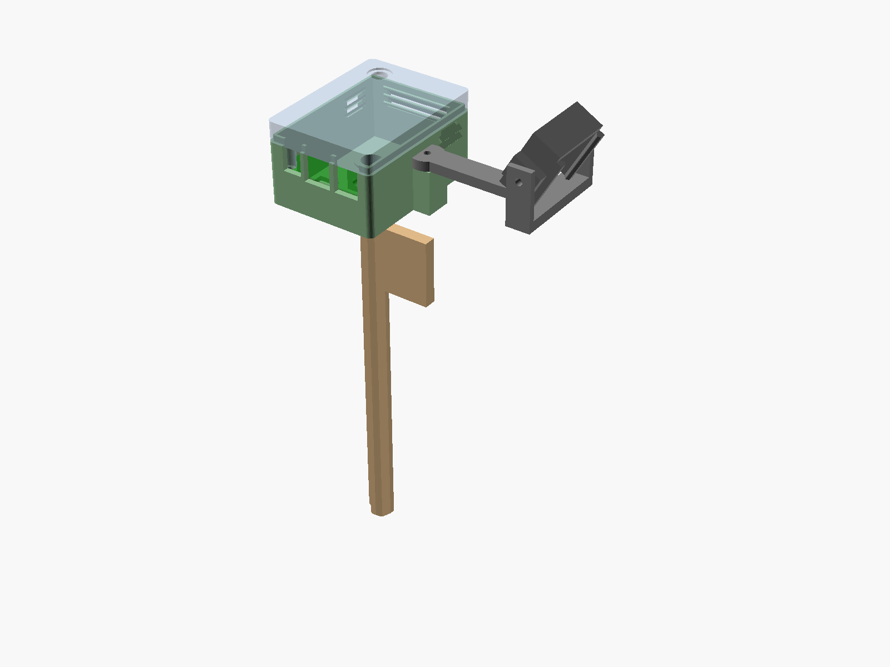

# Sensor pod enclosure

Clamshell housing for the 50 × 70 mm sensor-pod board, on a stake in the pot.
Source: [`pod.scad`](pod.scad). Previews: [assembly](preview_assembly.png),
[print plate](preview_print_plate.png).



## Parts

| STL | What | Size (mm) | Orientation in the STL |
|---|---|---|---|
| `stl/base.stl` | bottom half: PCB standoffs, three USB windows, drip louvres, stake socket, camera-arm lug | 68 × 79 × 34 | floor on the bed |
| `stl/lid.stl` | top half: light window over the BH1750, two screw bosses | 57 × 77 × 24 | top face on the bed (bosses point up) |
| `stl/stake.stl` | printed stake, cruciform, with the soil-probe holder | 213 long | lying down, rolled 45° so it rests on two blade edges — **use a brim** |
| `stl/cam_arm.stl` | arm from the pod to the camera (pan at the pod, tilt at the camera) | 78 × 51 × 29 | flat, prongs up |
| `stl/cam_cradle.stl` | clip that holds the thermal camera | 44 × 32 × 18 | back plate on the bed |

Skip `stake.stl` if you use a 10 mm wooden dowel instead.

## Printing

- **Material:** PETG or ASA. The pod sits next to a misted plant; PLA goes soft in sun and swells with moisture.
- **Layer height:** 0.2 mm. 0.15 mm if you want the louvres crisper.
- **Walls:** 3 perimeters (the shell walls are 3 mm, floor and lid 2.4 mm).
- **Infill:** 25 %. The stake benefits from 40 % or 4 perimeters.
- **Supports:** none. Every part is exported in its print orientation and
  `../check_stl.py` confirms no surface overhangs more than 45°. The only
  bridges are the tops of the USB windows (≤ 14 mm) and the 2 mm ring
  around the light window.
- **Brim:** on the stake (long and thin) and optionally the camera arm.

## Hardware

| Qty | Item | Where |
|---|---|---|
| 2 | M2.5 heat-set insert (Ø 3.5 hole, 5.5 deep) | ends of the two lid bosses |
| 2 | M2.5 × 25 pan-head screw | from underneath: through the floor, standoff and PCB hole, into the lid boss. One screw per corner closes the clamshell and clamps the board. |
| 1 | M3 heat-set insert + M3 × 6 grub or pan screw | side of the stake socket (inside the base) — pinches the dowel / stake spigot |
| 1 | M3 heat-set insert + M3 × 10 screw + washer | top of the lug on the +X wall — the arm's pan pivot |
| 2 | M3 heat-set insert + M3 × 8 screw | the two pads on the camera cradle — the tilt pivots, one each side |
| 1 | 10 mm hardwood dowel **or** `stake.stl` | socket under the board centre |
| 1 | clear disc Ø 12 × 1 mm (PET from blister packaging, or acrylic) + a drop of CA/epoxy | recess in the lid over the BH1750 |
| 1 | optional bead of neutral-cure silicone | parting line, if the pot is misted heavily |

M2.5 inserts: ruthex / CNC Kitchen style, OD ≈ 3.6 mm. M3 inserts OD ≈ 4.6 mm, 4.0 mm holes.

## Assembly

1. Heat-set the inserts: two in the lid bosses, one in the socket block, one in the lug, two in the cradle pads.
2. Glue the clear disc into the lid recess (window over the light sensor). If you prefer the sensor fully open to the sky, leave it out; rain will then land on the BH1750.
3. Pass the soil-probe lead (with its JST-XH plug) up through the slot in the floor.
4. Drop the PCB in from above, connector edge first: the three USB windows are open to the rim so the receptacles slide straight down into them.
5. Put the lid on, turn the pod over and drive the two M2.5 × 25 screws up from the counterbores in the floor.
6. Push the dowel or stake spigot into the socket and tighten the M3 set screw (reach it with the lid off, before step 5, or leave it finger-tight).
7. Printed stake: slide the capacitive probe **up** from below into the rails behind the pad until it hits the top stop; components face outward, the bare back of the PCB against the pad. Push the stake into the pot until the pod floor is about 5 cm above the soil.
8. Camera: slide the camera into the cradle from the open (USB-C) end until it clicks over the bump; screw the cradle between the arm prongs (M3 × 8 each side); screw the arm's root disc onto the lug (M3 × 10). Snug the screws to set friction; loosen to re-aim.

## How it is laid out

```
        y = 70 (sensor end)                 base, seen from above
   ┌──────══════════════──────┐  ← end-wall louvre (drip blades)
   │  (10,62) BH1750 ← window in the lid       (35,62) BME280   │
 ║ │                                                          │ ║ side louvres
   │  JST slot (8,22)      socket (25,35)                     │     on both walls
   │                                                          │  ■ lug for camera arm (y=35)
   │   [USB-C x=10]   [USB-A x=24]   [USB-B x=40]             │
   └──────────────────────────────────────────────────────────┘
        y = 0 (connector end)  — windows open to the rim
```

- PCB clearance is 0.3 mm all round, standoffs 14 mm high (the stake socket tube lives underneath).
- The base rim has a 3 mm lip that the lid skirt laps over, so water running off the lid never reaches the joint.
- Weep hole in the floor near the connector end drains any condensation.

### Why the top is not louvred

A Venetian-style louvre in a *horizontal* lid cannot shed rain: whatever drips
off one slat lands below the next and ends up inside. So the lid is solid, the
light sensor gets a flush clear window, and the air for the BME280 comes
through 45° drip louvres in the upper part of the end wall and both side walls
(blade tips stick out 2 mm, so drips run off outward). Lux readings through a
clear disc are relative, not absolute, which is all the plant-care loop needs.

## Parameters you are most likely to change

All at the top of `pod.scad`:

- `pcb_x`, `pcb_y`, `pcb_holes` — copy from the KiCad board in `hardware/pod/`.
- `usb_c_x`, `usb_a_x`, `usb_b_x` and `*_zoff` — connector centres along the y=0 edge; `zoff` is 1.6 when the jack sits on a breakout.
- `bh1750_pos`, `bme280_pos` — sensor positions (lid window, louvre placement).
- `probe_slot_pos` — where the soil lead comes through the floor.
- `dowel_d` — dowel diameter (socket and spigot follow).
- `cam_arm_len`, `cam_w/h/d` — arm reach and camera body size.
- `standoff_h` — raise it if tall through-hole leads need room under the board.
